# DIY 1–20 MHz Vector Network Analyzer (VNA) & Real-Time Python Suite

<p align="center">
  <a href="https://www.python.org/"></a>
  <a href="https://www.st.com/en/microcontrollers-microprocessors/stm32g4-series.html"></a>
  <a href="https://www.st.com/en/embedded-software/stm32cubeg4.html"></a>
  <a href="https://numpy.org/"></a>
  <a href="https://matplotlib.org/"></a>
  
</p>

> A from-scratch, heterodyne 1-port VNA: analog RF front-end → STM32G474 I/Q demodulation → Python SOL calibration and live Smith chart.

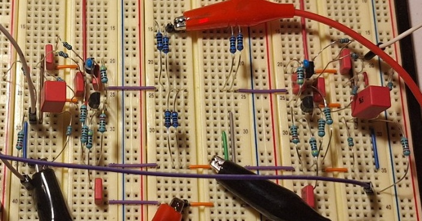

---

## Contents

1. [Overview](#overview)
2. [Key Engineering Highlights](#key-engineering-highlights)
3. [System Architecture](#system-architecture)
4. [Hardware and Firmware Design](#hardware-and-firmware-design)
   - [Analog Front-End](#1-analog-front-end-afe)
   - [Embedded DSP](#2-embedded-dsp-stm32-firmware)
   - [Calibration Mathematics](#3-calibration-mathematics-1-port-sol)
5. [Measurements and Results](#measurements-and-results)
   - [Signal-Chain Verification (Oscilloscope)](#signal-chain-verification-oscilloscope)
   - [Summary of Measured DUTs](#summary-of-measured-duts)
   - [Resistive Loads](#1-resistive-loads)
   - [Reactive Loads](#2-reactive-loads)
   - [Case Study: L-Network Impedance Matching](#3-case-study-l-network-impedance-matching)
6. [Limitations and Future Work](#limitations-and-future-work)
7. [Repository Structure](#repository-structure)
8. [Getting Started](#getting-started)
9. [Author](#author)

---

## Overview

A custom-designed, heterodyne **1–20 MHz Vector Network Analyzer (VNA)** built from scratch to measure complex reflection coefficients (Γ), Return Loss (S11), and complex impedance (Z = R + jX).

The system combines an analog RF front-end (transistor isolation buffers, RF mixers, and anti-aliasing RC filters) with Digital Signal Processing (DSP) on an **STM32G474** microcontroller and a **Python** instrument orchestration suite.

| | |
| :--- | :--- |
| **Frequency range** | 1–20 MHz, linear or logarithmic sweep |
| **Architecture** | Heterodyne, LO = RF − 10 kHz → 10 kHz IF |
| **Acquisition** | 100 kSPS, 12-bit ADC, timer-triggered with DMA, 10-point I/Q demodulation |
| **Calibration** | Broadband 1-port Short-Open-Load (Ed, Es, Er) |
| **Effective dynamic range** | > 40 dB (calibrated 50 Ω return-loss floor between −41 dB and −70 dB) |
| **Outputs** | Γ, S11 (dB), Z = R + jX, live Smith chart |
| **Validated on** | Resistive and reactive DUTs, plus a built L-match matching network |

---

## Key Engineering Highlights

* **RF Circuit Theory & Downconversion:** Implements heterodyne mixing to downconvert a swept 1–20 MHz RF signal to a phase-coherent **10 kHz Intermediate Frequency (IF)** using a tracked Local Oscillator (LO = RF − 10 kHz).
* **Signal Integrity & Filtering:** Incorporates custom passive RC low-pass filtering after the mixer stage to attenuate high-frequency mixing products (RF + LO, up to 40 MHz) and prevent ADC aliasing.
* **Hands-On Lab Validation:** Verified stage by stage with a digital storage oscilloscope (Rigol DHO804) at four test points (divider, follower output, mixer output, ADC input), using a Vb − Va math trace to check amplitude and phase fidelity through the chain.
* **Deterministic Firmware DSP (C / STM32):** Uses hardware timer-triggered ADC conversions (`TIM2_TRGO`) and Direct Memory Access (DMA) for hardware-timed sampling at 100 kSPS, executing real-time In-Phase and Quadrature (I/Q) demodulation on the Cortex-M4F core.
* **Python Instrument Automation:** Features a custom serial driver for the **FeelTech FY6900** dual-channel Arbitrary Waveform Generator (AWG) synchronized with STM32 serial telemetry, non-blocking multi-threaded user input, and real-time Matplotlib `GridSpec` rendering.
* **AI-Assisted Workflow:** Leveraged Generative AI tools for rapid Python GUI prototyping and documentation structuring.

---

## System Architecture

```text
+-------------------------------------------------------------------------+
|                        PC (Python Control Suite)                        |
|  - FY6900 Dual-Channel Driver (ASCII over UART)                         |
|  - Broadband 1-Port SOL Calibration Engine (Ed, Es, Er)                 |
|  - Real-Time Smith Chart & Cartesian S11 Plotting                       |
+-------------------+---------------------------------+-------------------+
                    | USB/Serial (COM7)               | USB/Serial (COM5)
                    v                                 ^
+-----------------------------------+ +-----------------------------------+
|     FeelTech FY6900 Dual AWG      | |        STM32G474 MCU (DSP)        |
|  - CH1 (RF): 1.000 to 20.000 MHz  | |  - TIM2 Triggered ADC1 (100 kSPS) |
|  - CH2 (LO): RF - 10.000 kHz      | |  - Dual-Channel DMA               |
+--------+-----------------+--------+ |  - 10-Point Synchronous I/Q Demod |
         | RF              | LO       +-----------------+-----------------+
         v                 |                            ^
+------------------+       |          +-----------------+-----------------+
|  Res. Dividers   |       |          |          RC Low-Pass Filters      |
|  Ref (A) / DUT(B)|       |          |  Passes 10 kHz IF | Cuts ~40 MHz  |
+--------+---------+       |          +-----------------+-----------------+
         |                 |                            ^
         v                 v                            |
+-------------------------------------------------------+-----------------+
|                Buffer Transistors & RF Mixers                           |
|           Isolates Branches A & B -> Mixes RF with LO                   |
+-------------------------------------------------------------------------+
```

---

## Hardware and Firmware Design

### 1. Analog Front-End (AFE)

The AFE turns the RF stimulus into two phase-coherent 10 kHz IF signals — one proportional to the **reference** voltage (Va) and one to the **test-port** voltage (Vb) — that the STM32 can sample directly.

#### 1.1 Stimulus & Test-Port Bridge

Channel 1 of the FY6900 (RF, 2 Vpp, 1–20 MHz) drives two resistive voltage dividers connected to the same source node (Channel 2 supplies the LO = RF - 10 kHz, injected at each mixer; see 1.2):

| Branch | Divider | Node |
| :--- | :--- | :--- |
| **A – Reference** | 50 Ω series / 50 Ω to GND | **Va** = Vs / 2 |
| **B – Test port** | 50 Ω series / DUT to GND | **Vb** = Vs · Z / (Z + 50 Ω) |

Because both branches share one source node, the amplitude of the source cancels in the ratio of the two measured voltages:

```text
Vb / Va = 2Z / (Z + 50) = 1 + Γ
```

So the raw complex ratio `M = Vb / Va` is directly related to the DUT reflection coefficient. All remaining non-idealities (mixer imbalance, filter phase, breadboard parasitics) are removed by the SOL calibration described below.

#### 1.2 Per-Channel Signal Chain

Branches A and B use an identical chain (a buffer, a mixer and an output filter each), so that gain and phase errors common to both cancel in `Vb / Va`. Any residual branch-to-branch mismatch (a few percent in amplitude, see Signal-Chain Verification) is a fixed error that the SOL calibration removes. Each stage was probed on the bench; see [Signal-Chain Verification](#signal-chain-verification-oscilloscope).

| Stage | Circuit | Purpose |
| :--- | :--- | :--- |
| **Input coupling & bias** | 100 nF series capacitor into the base of Q1. Base bias from the 9 V rail through a 2 × 10 kΩ divider (≈ 4.5 V) with a 100 nF decoupling capacitor to GND. | Blocks the DC level of the divider node; sets Q1 at mid-supply. |
| **Buffer (Q1)** | NPN emitter follower: collector to +9 V, emitter to GND through 1 kΩ. | High input impedance isolates the 50 Ω measurement nodes from the mixer, and presents a low impedance to the next stage. |
| **Interstage coupling & bias** | 100 nF series capacitor from the Q1 emitter into the base of Q2. Base bias from 9 V through 10 kΩ / 2.2 kΩ (≈ 1.6 V). | AC-couples the RF; biases Q2 for roughly 1 mA of quiescent current. |
| **Mixer (Q2)** | NPN stage: emitter to GND through 1 kΩ, collector to +9 V through 4.7 kΩ in parallel with 1 nF. RF enters at the base; the LO (CH2) is injected at the emitter through 100 nF + 470 Ω. | The exponential I<sub>C</sub>–V<sub>BE</sub> characteristic multiplies RF and LO, producing f<sub>RF</sub> − f<sub>LO</sub> = **10 kHz** and f<sub>RF</sub> + f<sub>LO</sub>. |
| **Output low-pass filter** | 4.7 kΩ collector resistor in parallel with a 1 nF capacitor from the collector to +9 V (AC ground). | Passes the 10 kHz IF and attenuates the RF, LO and higher frequencies. |
| **ADC coupling & bias** | 1 µF series capacitor; the node is biased to 1.65 V from the STM32 3.3 V rail through a 2 × 10 kΩ divider; 2.2 kΩ series resistor into the ADC pin for overvoltage safety. | Re-centres the IF on mid-scale of the 12-bit ADC and isolates the ADC sampling capacitor. |

#### 1.3 IF Filtering

The collector filter has a corner frequency of

```text
f_c = 1 / (2π · 4.7 kΩ · 1 nF) ≈ 34 kHz   (unloaded)
```

* **10 kHz IF (unloaded):** about −0.4 dB and −16° of phase — identical in both channels, so it cancels in `Vb / Va`.
* **Sum products (≈ 2–40 MHz, unloaded):** a single-pole roll-off gives roughly 35 dB (at 2 MHz) to 60 dB (at 40 MHz) of suppression before the signal reaches the ADC.

The downstream ADC bias network (≈ 5 kΩ to AC ground) loads the collector node: 4.7 kΩ ∥ 5 kΩ ≈ 2.4 kΩ roughly doubles the effective corner to ≈ 66 kHz. With that loading the 10 kHz IF sees about −0.1 dB and −9°, and the sum products are suppressed by about 30 dB (at 2 MHz) to 56 dB (at 40 MHz). Both channels are loaded identically, so the common-mode argument above is unchanged.

### 2. Embedded DSP (STM32 Firmware)

The STM32G474 runs at a 170 MHz system clock:

* **Synchronous Sampling:** TIM2 is configured with `Prescaler = 169` and `Period = 9`, generating a precise 100 kHz trigger (`TIM_TRGO_UPDATE`).
* **Interleaved DMA Acquisition:** ADC1 scans `ADC_CHANNEL_1` (Branch A) and `ADC_CHANNEL_5` (Branch B) in 12-bit resolution, transferring `TOTAL_SAMPLES = 2000` (1000 per channel) directly into RAM via `DMA1_Channel1`.
* **Quadrature Demodulation:** Because the 10 kHz IF signal is sampled at exactly 100 kHz, each signal period corresponds to exactly 10 samples. The firmware correlates the DC-centered ADC samples against 10-element lookup tables (`cos_ref` and `sin_ref`) to extract In-Phase (I) and Quadrature (Q) components.

### 3. Calibration Mathematics (1-Port SOL)

To remove systematic hardware errors — such as mixer imbalance, filter phase shift, and breadboard stray capacitance — the Python suite implements full Broadband Short-Open-Load (SOL) vector error correction across every frequency step. The measured ratio is modelled with the standard one-port error terms:

```text
M = Ed + Er · Γ / (1 − Es · Γ)
```

* **Directivity Error (Ed):** Measured directly using a 50 Ω precision load (`Ed = M_load`).
* **Source Match Error (Es):** Computed from Open, Short, and Load standards (`Es = (M_open + M_short - 2 * Ed) / (M_open - M_short)`).
* **Reflection Tracking Error (Er):** Computed as `Er = (M_open - Ed) * (1 - Es)`.

> Because the ideal bridge ratio is `M = 1 + Γ`, the constant "+1" is absorbed into `Ed` (an ideal instrument gives Ed = 1, Er = 1, Es = 0).

During live DUT measurements, the true complex reflection coefficient Γ is recovered from the raw complex ratio `M_dut = Vb / Va`:

```text
Γ_corrected = (M_dut - Ed) / (Er + Es * (M_dut - Ed))
Z_dut = 50.0 * (1.0 + Γ_corrected) / (1.0 - Γ_corrected)
```

---

## Measurements and Results

### Measurement Setup

Every DUT below was measured after a broadband 1–20 MHz SOL calibration, using a **logarithmic frequency sweep**. Each DUT was captured twice:

* **Cartesian** return loss (S11, dB vs. frequency) with `vna_cartesian.py`
* **Swept Smith chart** (impedance locus) with `vna_smith.py`, Mode 2

### Signal-Chain Verification (Oscilloscope)

Before trusting the calibrated results, the analog chain was verified stage by stage with a Rigol DHO804 oscilloscope at four test points. Every capture shows:

* **CH1 = Va** (reference branch)
* **CH2 = Vb** (test-port branch)
* **Math = Vb − Va**

All channels are **AC-coupled**, because each node sits at a different DC operating point set by its bias network, and only the signal itself is of interest.

**Why Vb − Va?** From the bridge equations in Section 1.1:

```text
Vb − Va = Va · (Z − 50) / (Z + 50) = Γ · Va
```

So the amplitude ratio `|Math| / |Va|` equals `|Γ|`, and the phase of Math relative to Va equals `∠Γ` — in effect a single-frequency S11 measurement done by hand on the scope. If the two branches are identical, both quantities have to survive the whole chain from the divider to the ADC pin.

**Capture conditions:** DUT = `100.00 - j15.9 Ω` (nominal 100 Ω + 1 nF at 10 MHz), f<sub>RF</sub> = `10 MHz` (LO = f<sub>RF</sub> − 10 kHz). For this DUT the ideal is |Γ| = 0.348 ∠ −11.6°, so ideal Math / Va = 0.348 and ideal phase = −11.6°.

<table>
  <tr>
    <td align="center" width="50%">
      <b>TP1 – Resistive dividers</b><br><sub>RF · Va and Vb nodes</sub><br>
      
    </td>
    <td align="center" width="50%">
      <b>TP2 – After the emitter follower (Q1)</b><br><sub>RF · Q1 emitter</sub><br>
      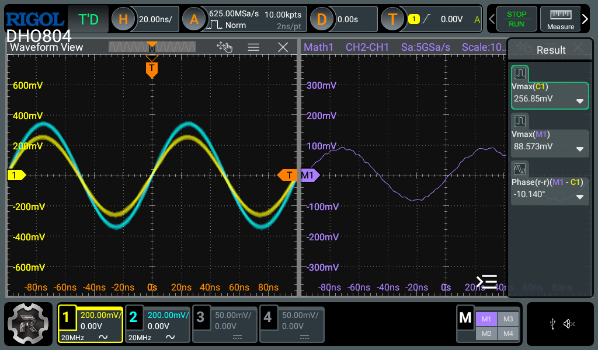
    </td>
  </tr>
  <tr>
    <td align="center" width="50%">
      <b>TP3 – After the mixer and RC filter (Q2)</b><br><sub>10 kHz IF · Q2 collector</sub><br>
      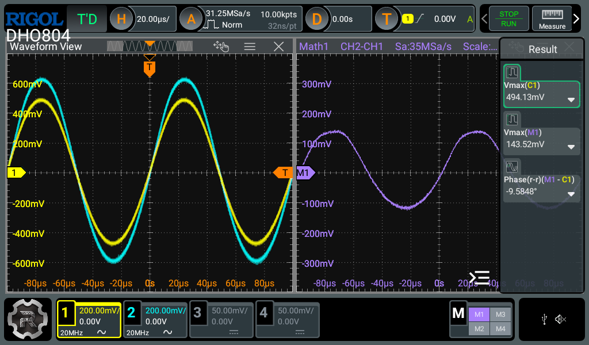
    </td>
    <td align="center" width="50%">
      <b>TP4 – After the ADC DC-bias network</b><br><sub>10 kHz IF · STM32 ADC input</sub><br>
      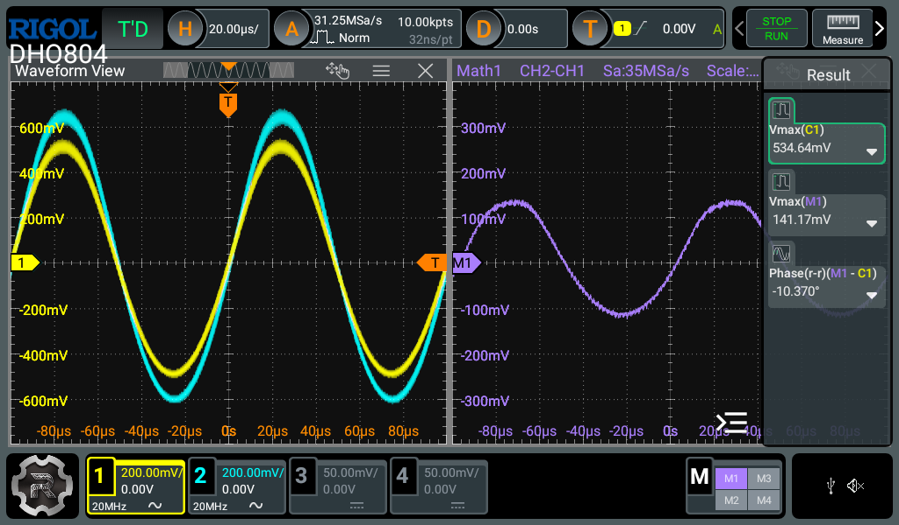
    </td>
  </tr>
</table>

| Test point | Signal | Va (V<sub>max</sub>) | Math = Vb − Va (V<sub>max</sub>) | Math / Va | Phase, Math vs Va (rising-to-rising) |
| :--- | :---: | :---: | :---: | :---: | :---: |
| **TP1** – dividers | RF | `255.28 mV` | `94.84 mV` | `0.37` | -8.6° |
| **TP2** – after follower | RF | `256.85 mV` | `88.57 mV` | `0.34` | -10.1° |
| **TP3** – after mixer + RC filter | 10 kHz IF | `494.13 mV` | `143.52 mV` | `0.29` | -9.58° |
| **TP4** – after ADC DC bias | 10 kHz IF | `534.64 mV` | `141.17 mV` | `0.26` | -10.37° |

**Result:** the phase of Math relative to Va stays between −8.6° and −10.4° at all four test points, within about 3° of the ideal −11.6° and within the trigger-jitter spread of a rising-edge phase readout on single-shot captures. Because both mixers share the same low-side LO (f_LO = f_RF − 10 kHz), downconversion preserves both the magnitude and sign of the phase difference between the two branches, and within the resolution of the scope the two chains add no differential phase of their own.

The amplitude ratio Math / Va shifts from about 0.35 at the RF stages down to 0.26 at the IF stages, against an ideal 0.348. While this looks like a severe drift, it is actually a combination of a small hardware variance magnified by subtraction and oscilloscope measurement artifacts. First, because Math is the difference between two nearly equal signals (Vb − Va), a routine 4–5% gain mismatch between the transistor mixers could translates into a drastic drop in the calculated ratio. Second, absolute voltage measurements from single scope captures should not be read too strictly, as residual high-frequency harmonics artificially inflate the scope's single-sample Vmax readings and skew the ratio further. Ultimately, the true underlying hardware mismatch is a fixed, linear error that the software SOL calibration completely maps out and removes, as the load tests below confirm.

At TP3 and TP4 the RC low-pass filter has removed the RF + LO mixing products (up to ≈ 40 MHz), leaving a clean 10.00 kHz sinusoidal IF at the STM32 ADC inputs.

### Summary of Measured DUTs

The "Ideal response" column is what a perfect VNA would show for each DUT (Z0 = 50 Ω, ideal components).

| # | DUT | Ideal response | What it validates |
| :-: | :--- | :--- | :--- |
| 1 | 23.5 Ω | Γ = −0.36, S11 = −8.9 dB, flat | Magnitude and sign of reflection below 50 Ω |
| 2 | 50 Ω | Γ = 0, S11 → −∞ dB | Noise floor and repeatability |
| 3 | 100 Ω | Γ = +0.333, S11 = −9.54 dB, flat | Magnitude and sign of reflection above 50 Ω |
| 4 | 100 Ω + 10 µH (series) | S11 ≈ −6.1 dB at 1 MHz → ≈ −0.05 dB at 20 MHz | Inductive (upper-half) phase tracking |
| 5 | 100 Ω + 1 nF (series) | S11 ≈ −2.4 dB at 1 MHz → ≈ −9.5 dB at 20 MHz | Capacitive (lower-half) phase tracking |
| 6 | L-match: 100 Ω ∥ 10 µH, series 2 nF | Γ = 0 at f0 ≈ 1.59 MHz | End-to-end use as a matching-network design tool |

### 1. Resistive Loads

Pure resistors are the simplest check: with no reactive part, the impedance locus collapses to a single point on the real axis of the Smith chart and the return loss is flat across the whole sweep. Any frequency dependence in these plots comes from the instrument and the breadboard, not from the DUT.

#### 23.5 Ω

Ideal: Γ = −0.36 (phase 180°), S11 = −8.9 dB. On the Smith chart the point sits on the real axis at normalized r = 0.47.

| Smith chart | Return loss (S11) |
| :---: | :---: |
| 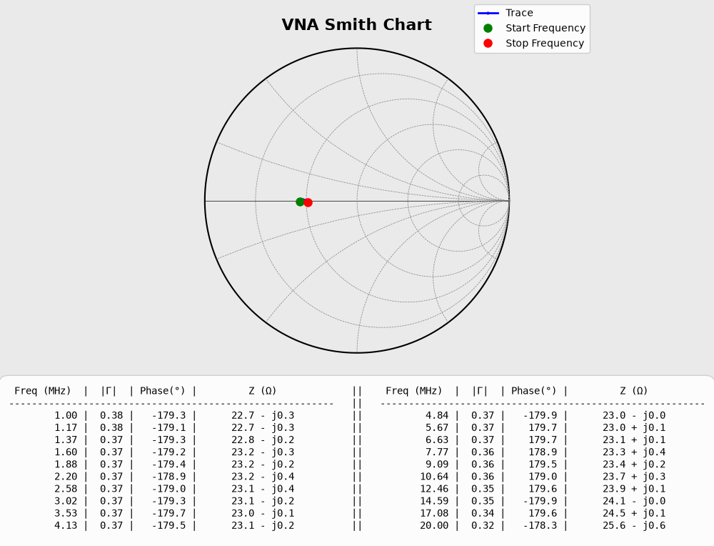 | 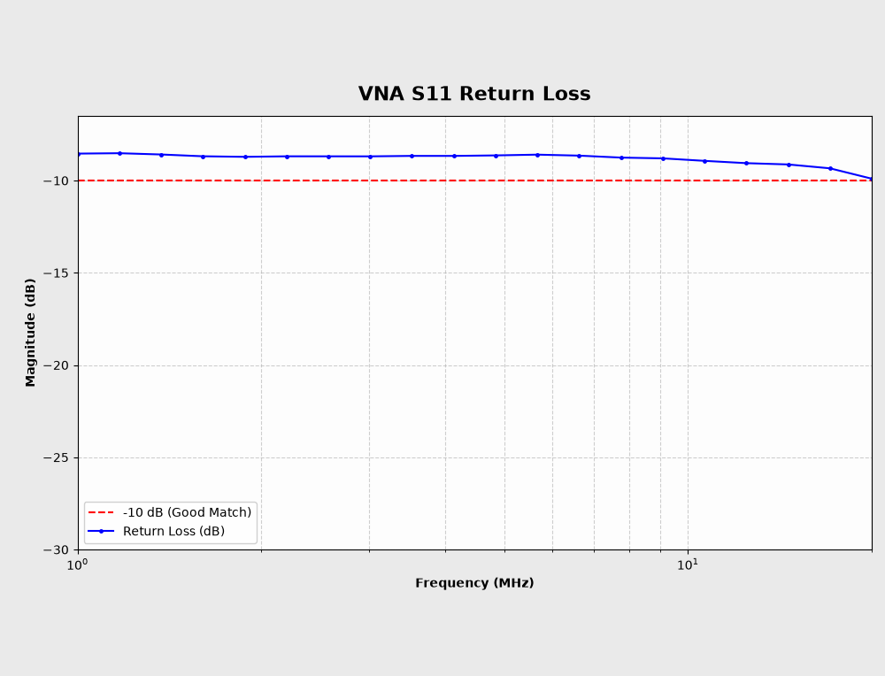 |

#### 50 Ω

Ideal: Γ = 0, so this measurement shows the **noise and repeatability floor** of the calibrated instrument. Because the directivity term is taken from the 50 Ω load itself (`Ed = M_load`), this is not an independent directivity measurement: a separate 50 Ω resistor with 1 % tolerance would by itself limit such a check to about −46 dB. Across the full 1–20 MHz bandwidth, the calibrated 50 Ω return loss remains between **−41 dB and −70 dB**, i.e. **>40 dB of usable dynamic range** within the repeatability of the setup.

| Smith chart | Return loss (S11) |
| :---: | :---: |
| 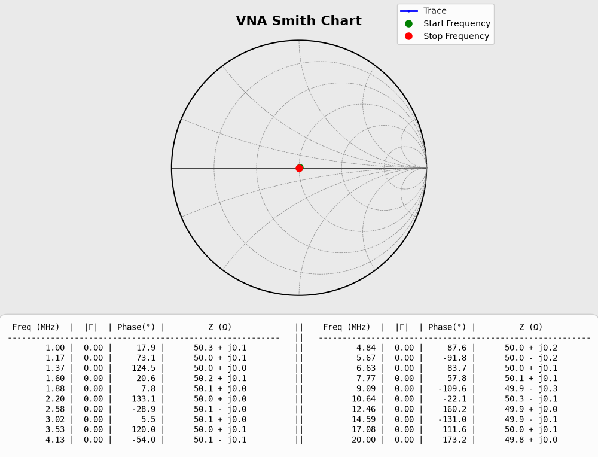 | 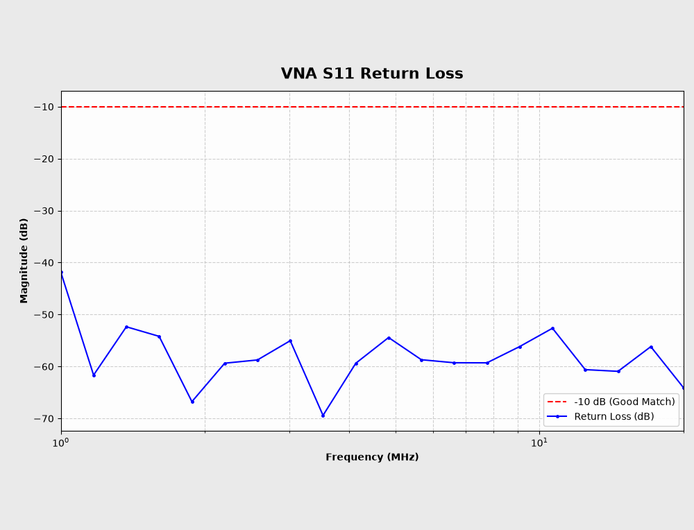 |

#### 100 Ω

Ideal: Γ = +1/3 (phase 0°), S11 = −9.54 dB. The point sits on the real axis at normalized r = 2.0. Together with the 23.5 Ω load, this is an out-of-calibration check on both sides of the 50 Ω reference.

| Smith chart | Return loss (S11) |
| :---: | :---: |
| 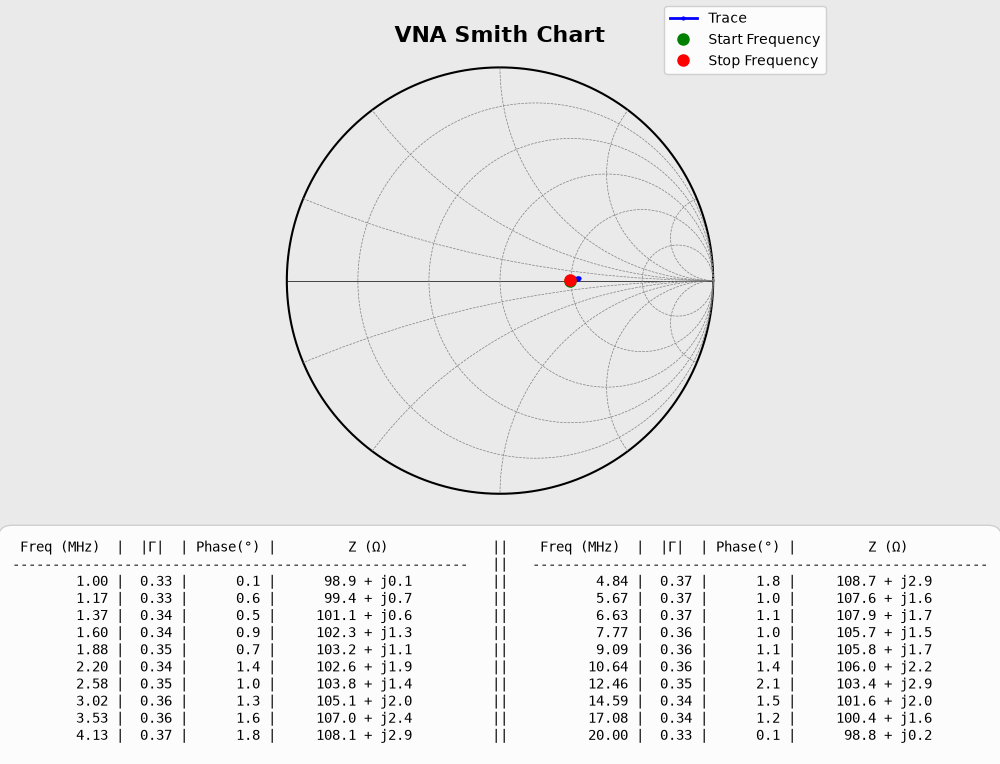 | 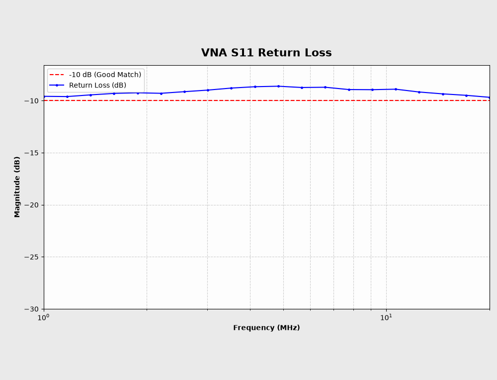 |

### 2. Reactive Loads

Adding a series reactance to a resistive load moves the impedance along a **constant-resistance circle** on the Smith chart: into the upper half for an inductor (+jX) and into the lower half for a capacitor (−jX). As the reactance X increases, the point rotates **clockwise** along that circle. These sweeps test whether the instrument tracks the *phase* of Γ correctly, not just its magnitude.

#### 100 Ω + 10 µH (series)

The inductor reactance grows from X<sub>L</sub> = 2πfL ≈ 63 Ω at 1 MHz to ≈ 1.26 kΩ at 20 MHz (impedance measurement is unreliable near the open-circuit point). The locus starts above the 100 Ω point, travels clockwise up the r = 2 circle, and approaches the open-circuit point at the right edge of the chart as frequency increases. S11 climbs from ≈ −6.1 dB toward 0 dB (almost total reflection); the path is not a perfect circle because of non-idealities in the circuit.

| Smith chart | Return loss (S11) |
| :---: | :---: |
| 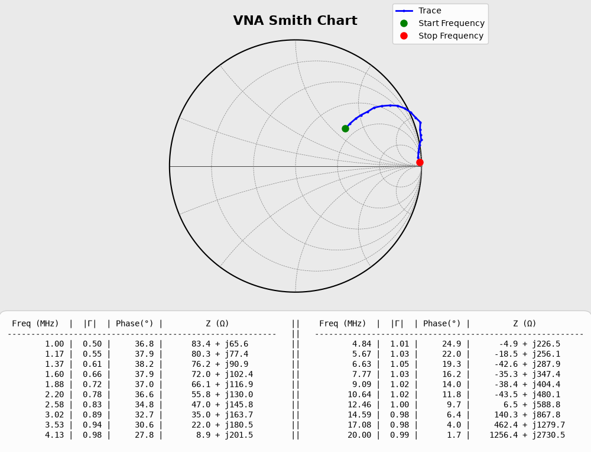 | 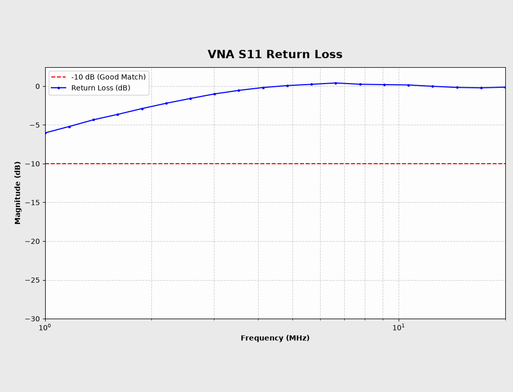 |

#### 100 Ω + 1 nF (series)

The capacitor reactance shrinks in magnitude from X<sub>C</sub> = −1/(2πfC) ≈ −159 Ω at 1 MHz to ≈ −8 Ω at 20 MHz. The locus starts in the lower (capacitive) half of the chart and, as X rises toward zero, travels clockwise along the r = 2 circle back toward the plain 100 Ω point, while S11 improves from ≈ −2.4 dB to ≈ −9.5 dB — converging to the pure 100 Ω level (again the path is not a perfect circle because of non-idealities in the circuit).

| Smith chart | Return loss (S11) |
| :---: | :---: |
| 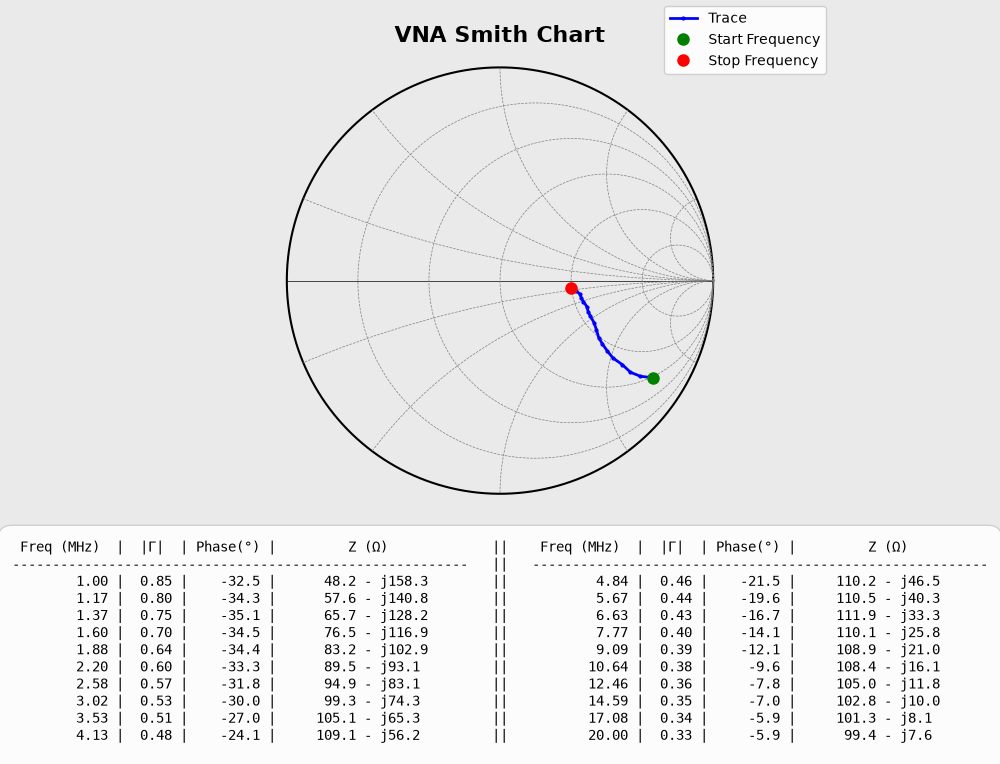 | 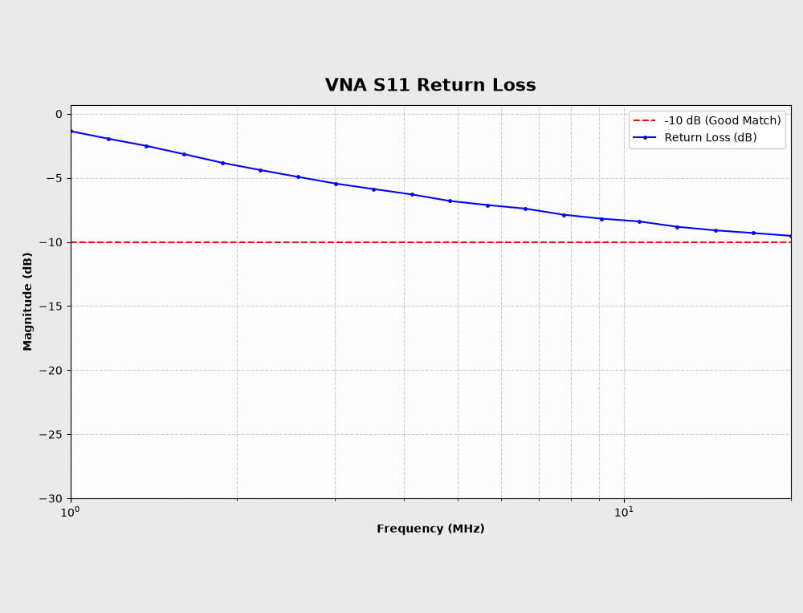 |

### 3. Case Study: L-Network Impedance Matching

To demonstrate practical RF circuit design, an L-match (shunt inductor across the load, series capacitor toward the VNA port) was built to match a 100 Ω load to 50 Ω.

**Design:**

```text
Q            = sqrt(R_L / Z0 - 1) = sqrt(100 / 50 - 1) = 1
X_shunt (L)  = R_L / Q = 100 Ω   ->  L = 100 / (2π·f0) = 10 µH
X_series (C) = Q · Z0  =  50 Ω   ->  C = 1 / (2π·f0·50) = 2 nF
f0           = R_L / (2π · L · Q) ≈ 1.59 MHz
```

**Impedance walk-through at f0:**

* The unmatched load sits on the real axis at R = 100 Ω (|Γ| = 0.33, S11 ≈ −9.5 dB).
* The shunt inductor (X = 100 Ω at f0) converts 100 Ω ∥ j100 Ω into **50 + j50 Ω** — it moves the point along the constant-conductance circle onto the r = 1 circle.
* The series capacitor (X = −50 Ω at f0) cancels the +j50 Ω, landing at the **centre of the Smith chart (50 Ω)** and producing a deep return-loss null at f0.

Away from f0 the match degrades; at the top of the sweep the shunt inductor looks increasingly like an open circuit and the locus returns toward the unmatched 100 Ω point. The null depth is not perfect because the sweep point nearest f0 is 1.6 MHz (instead of 1.59 MHz), because of component tolerances, and because it is bounded by the calibrated noise floor measured in the 50 Ω test above.

| Smith chart | Return loss (S11) |
| :---: | :---: |
| 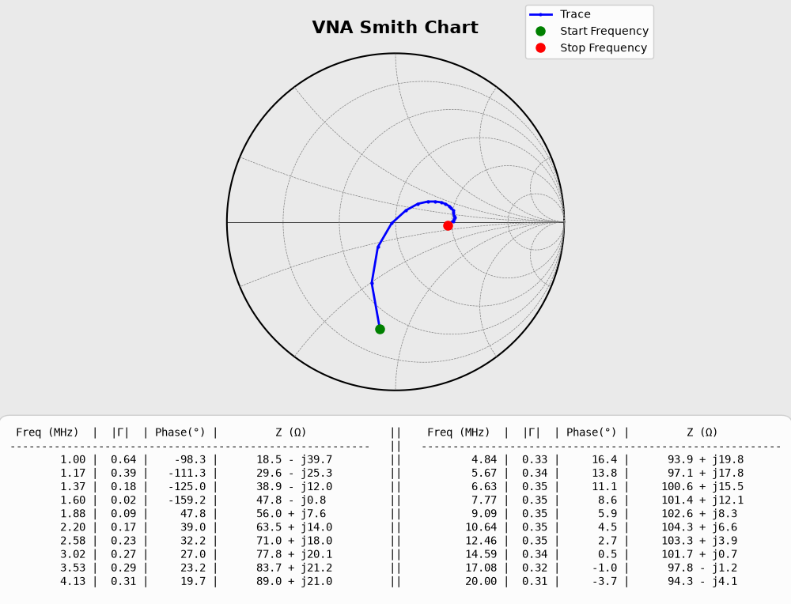 | 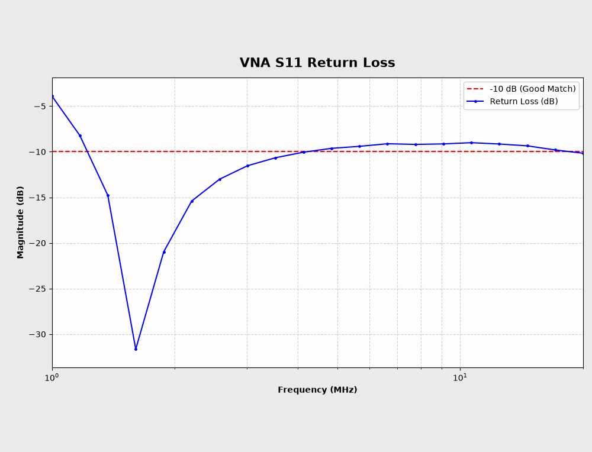 |

---

## Limitations and Future Work

Operating up to 20 MHz on a solderless breadboard introduces noticeable signal integrity challenges:

* **Parasitic Capacitance:** Adjacent breadboard strips add ~2–5 pF of stray capacitance, causing phase rotation at the upper end of the sweep (15–20 MHz).
* **Stray Inductance:** Jumper wires introduce series inductance (~10 nH/cm) and ground loop susceptibility.
* **Next Revision (PCB):** Transitioning the analog front-end to a 4-layer PCB with a continuous solid ground plane, 50 Ω controlled-impedance microstrip traces, SMA connectors, and a resistive Wheatstone bridge, targeting a usable bandwidth above 100 MHz.

---

## Repository Structure

```text
├── Firmware/
│   └── Core/Src/main.c         # STM32G474 HAL firmware (TIM2, ADC1 DMA, I/Q DSP)
├── Software/
│   ├── vna_calibrate.py        # Interactive Linear/Log SOL calibration & JSON export
│   ├── vna_cartesian.py        # Automated S11 Return Loss (dB) plotter & CSV logger
│   └── vna_smith.py            # Real-time Single/Swept Smith Chart GUI & Z table
├── docs/
│   ├── data/                   # S11, Gamma and Impedance measurements
│   └── images/
│       ├── hardware_setup.jpg  # Hardware photo
│       ├── scope/              # Oscilloscope captures (TP1–TP4)
│       └── plots/              # Smith charts and S11 plots
└── README.md
```

---

## Getting Started

### Prerequisites

**Hardware**

* FeelTech FY6900 dual-channel AWG (CH1 = RF, CH2 = LO)
* STM32G474 board
* The analog front-end described above
* Open, Short and 50 Ω Load calibration standards

**Software**

Install the required Python packages:

```bash
pip install pyserial numpy matplotlib
```

### Usage

1. **Flash the Firmware:** Compile and flash `main.c` onto the STM32G474 using STM32CubeIDE.

2. **Run Calibration:** Connect the FY6900 AWG (`COM7`) and the STM32 (`COM5`), then run (adjust the port names if yours differ):

   ```bash
   python Software/vna_calibrate.py
   ```

   Follow the prompts to select a Linear or Logarithmic sweep, the number of points, and to connect the Open, Short, and 50 Ω Load standards.

3. **Measure Return Loss (Cartesian):**

   ```bash
   python Software/vna_cartesian.py
   ```

4. **Launch the Real-Time Smith Chart GUI:**

   ```bash
   python Software/vna_smith.py
   ```

   Choose **Mode 1 (Single Frequency)** to tune matching networks live with dynamic frequency updates, or **Mode 2 (Broadband Sweep)** to view the full impedance locus and live impedance table.

---

## Author

**Panagiotis Konstantopoulos** · [LinkedIn](https://www.linkedin.com/in/panos-konstantopoulos/) · [GitHub](https://github.com/PanosKons) · panos.d.konstantopoulos@gmail.com
